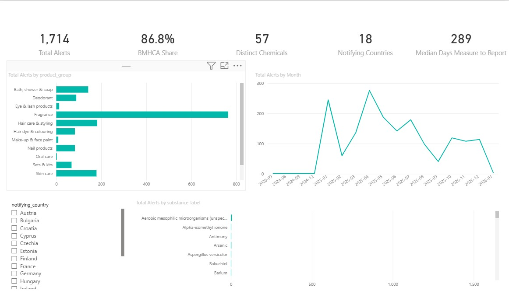
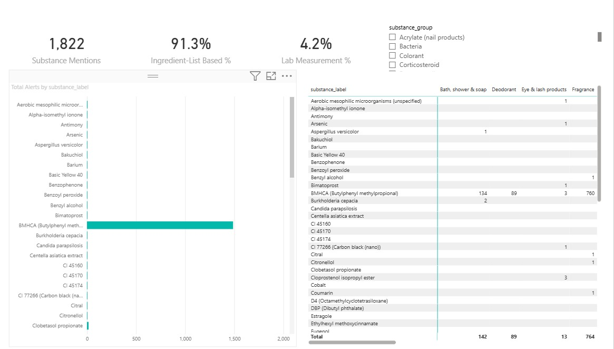
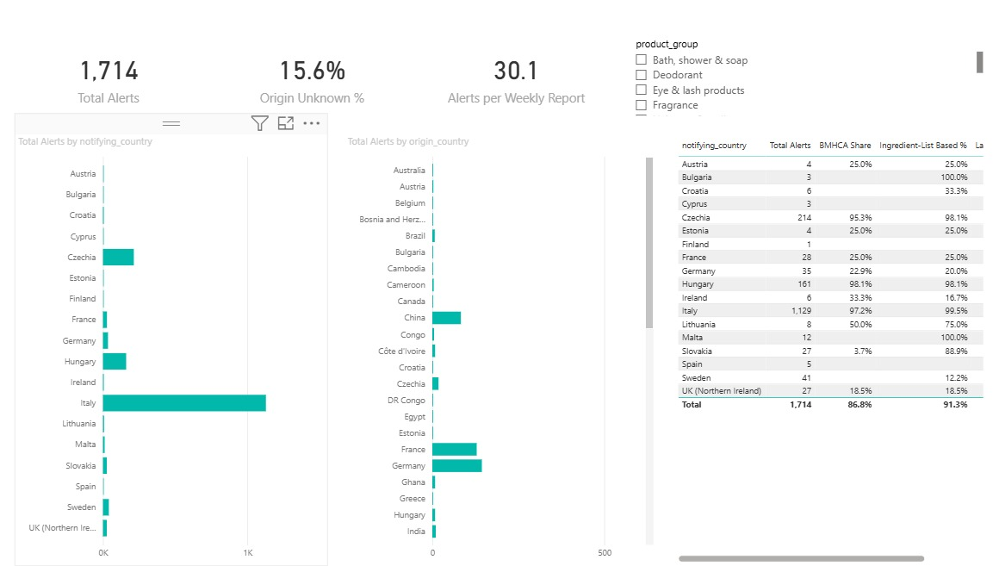
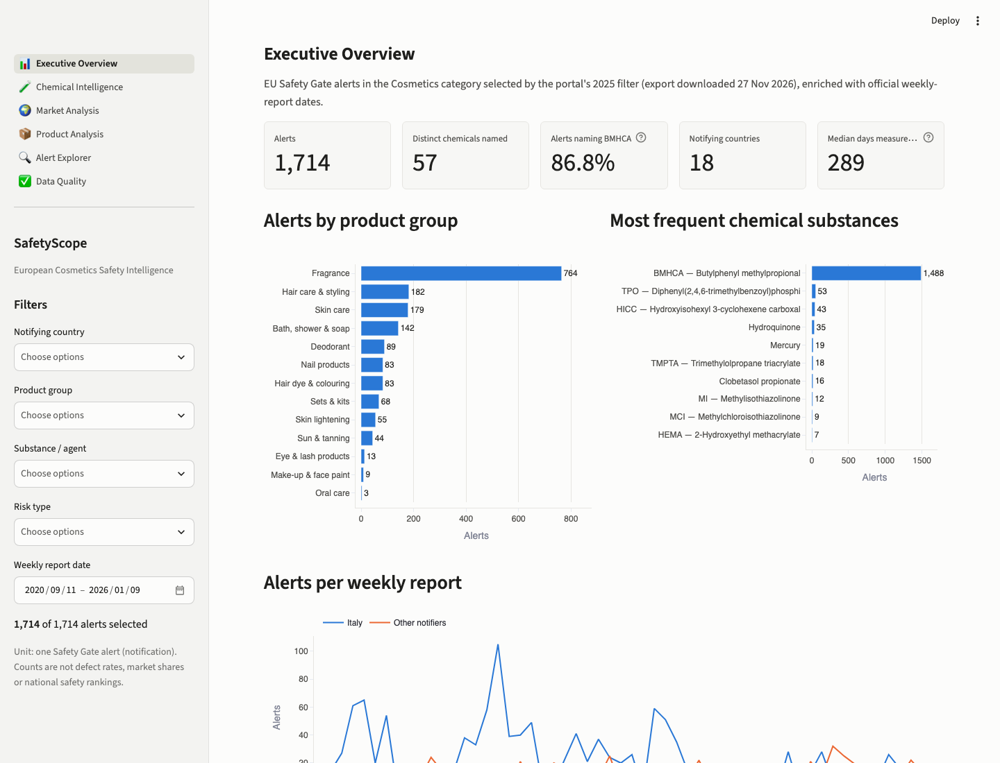

# SafetyScope — European Cosmetics Safety Intelligence

**An end-to-end analysis of 1,714 EU Safety Gate alerts on cosmetics (2025 reporting period):**
data validation, a reproducible ETL pipeline, chemical-substance extraction from free text, a SQL data model,
a Power BI report and a Streamlit analytics app.




## Why this project

Retailers, importers and regulatory-affairs teams need to know **which ingredients and product types trigger EU
safety alerts, which authorities notify them, and what corrective action follows**. The European Commission
publishes this in [Safety Gate](https://ec.europa.eu/safety-gate-alerts), but its exports are semi-structured:
substances are hidden in sentences, fields hold several values, spellings vary and there is no date column.

SafetyScope turns one export into validated, documented, queryable intelligence. It is a **2025-focused
retrospective analysis**, not a live monitoring service; an optional script can add newer alerts from the official
XML feed, but the published results describe the 2025 export.

**Practical applications:** ingredient and supplier risk screening, product-safety and QA prioritisation,
regulatory-affairs horizon scanning, and market-surveillance reporting.

## Key findings

| | Finding (verified from the data) |
|---|---|
| 🧪 | **One substance dominates.** BMHCA (Lilial) is named in **86.8%** of alerts. It has been prohibited in EU cosmetics since 1 March 2022 (Regulation (EU) 2021/1902). |
| 🧴 | **Fragrances** account for **44.6%** of alerts — eau de toilette and perfume alone for 696. |
| 🇮🇹 | **Italy notified 65.9%** of alerts: 97.2% BMHCA, 99.5% identified from the ingredient list, published a median **359 days** after the national measure (other countries: 53). |
| 💅 | **All 53 TPO alerts** (nail products) appeared on or after **1 Sep 2025**, when its prohibition began to apply (Regulation (EU) 2025/877). |
| 🌍 | Skin-lightening products (mercury, hydroquinone, clobetasol) come mostly from **outside the EU** and are mostly **rejected at the border**. |
| 🛑 | A **ban on marketing** follows in 75.4% of alerts; recalls from consumers in 8.2%. |

Counts measure **enforcement activity**, not defect rates or national safety rankings — no denominator (inspections,
products on the market) exists. Interpretations and hypotheses: [`reports/executive_summary.md`](reports/executive_summary.md).

## Dashboards

**Power BI** — 4 pages, opened and refreshed in Power BI Desktop; KPIs match the Python/SQL results
([`powerbi/SafetyScope.pbix`](powerbi/SafetyScope.pbix)).

<p>


</p>

**Streamlit** — 6 interactive pages with filters, a searchable alert explorer with links to each original
Safety Gate case, CSV download and a data-quality/provenance page.

<p>


</p>

More screenshots: [`assets/screenshots/`](assets/screenshots/).

## How it works

```
Safety Gate Excel export ─► extract ─► transform ─────────────────────► load ─► CSV · SQLite · Power BI tables
(original, unchanged)                  clean · standardise · split                │
Official XML weekly reports ─► dates   multivalued fields · regex NLP             ├─► Power BI report
                                                                                  ├─► Streamlit app
                                                                                  └─► SQL queries, reports, figures
```

| Step | What was done | Output |
|---|---|---|
| Validation | Reproduced the manual Excel PivotTables exactly (6 of 6 checkpoints) | [Profiling report](reports/data_profiling_report.md) |
| ETL | Normalised text, merged 231 product spellings into 180 types, parsed 2,027 corrective measures; original values kept alongside | [Cleaning report](reports/cleaning_report.md) |
| Dates | Matched all 1,714 alerts to official weekly reports; showed that alert-number year, publication date and measure date differ | [Date investigation](reports/date_investigation.md) |
| NLP | 67-entry regex dictionary with aliases and typo handling; CAS numbers checked against PubChem; compared with a pretrained chemical NER model | [Extraction evaluation](reports/substance_extraction_evaluation.md) |
| SQL | Star schema with bridge tables (no double counting); 20 business queries | [Database](docs/DATABASE.md) · [Results](reports/sql_results.md) |
| BI | Power BI model (5 relationships, 17 DAX measures) and Streamlit app | [Power BI guide](docs/POWER_BI_GUIDE.md) |

## Quick start

**Streamlit app** (Python 3.12; processed data is included):

```bash
python3.12 -m venv .venv && source .venv/bin/activate
pip install -r requirements.txt
streamlit run app/streamlit_app.py
```

Open <http://localhost:8501>. Stop with `Ctrl+C`.

**Power BI** (Windows): open `powerbi/SafetyScope.pbix`, or open the source project `powerbi/pbip/SafetyScope.pbip`
and point the `DataFolder` parameter to `powerbi\data\` — see the [Power BI guide](docs/POWER_BI_GUIDE.md).

<details>
<summary><b>Rebuild everything from the original export</b></summary>

```bash
python src/pipeline.py            # ETL -> data/processed/ + SQLite (uses the committed XML snapshot)
python src/profile_data.py        # profiling report
python src/investigate_dates.py   # date investigation
python src/cleaning_report.py
python src/evaluate_extraction.py # reuses cached model predictions (no model download)
python src/run_sql.py
python src/findings.py            # figures + executive summary
python src/build_powerbi.py
pytest                            # 46 tests
```

Optional: `python src/update_from_api.py` adds alerts published after the export date from the official XML feed;
`pip install -r requirements-optional.txt` is only needed to re-run the NER model comparison (~1 GB RAM).
</details>

## Repository structure

```
data/        original export, processed tables, reference data, evaluation labels, owner review workbook
src/         pipeline and analysis scripts (safetyscope/ package)
sql/         schema and business queries
app/         Streamlit application
powerbi/     PBIX, PBIP source, CSVs, DAX, Power Query, theme
reports/     profiling, cleaning, dates, NLP evaluation, SQL results, executive summary, figures
docs/        data dictionary, database, Power BI guide, decision log, journal, learning guide
analysis/    the original manual Excel analysis
tests/       automated data-quality, extraction, app, Power BI and ingestion tests
```

## Validation and limitations

- **Tested:** 46 automated tests (original file unchanged, Excel checkpoints, keys and relationships, measure parsing,
  extraction rules, every app page, Power BI schema validity, offline API ingestion); Power BI KPIs checked in Desktop.
- **NLP evaluation is limited.** Reference labels for the 60-text sample were written by an AI assistant, not a
  human annotator, and the rules were developed on the same data. The rule-based score (1.00) therefore shows
  internal consistency, not proven accuracy; the pretrained model scored precision 0.89 / recall 0.99 against the
  same labels. Human review is pending in `data/review/substance_review_for_owner.xlsx`.
- One export; the portal's year filter is undocumented (the best-fitting rule reproduces all rows).
- Product groups are a project-defined classification. The Power BI report still uses the default theme.

## AI-assisted development

This project was developed with an AI coding assistant (Claude, via Claude Code). The project owner defined the
business problem and requirements, supplied the data and the original manual Excel analysis, reviewed results and
validated the Power BI report on Windows; code, analyses and documentation were generated with AI assistance under
that direction. Details: [`docs/PROJECT_JOURNAL.md`](docs/PROJECT_JOURNAL.md) · decisions:
[`docs/DECISION_LOG.md`](docs/DECISION_LOG.md) · concepts explained: [`docs/LEARNING_GUIDE.md`](docs/LEARNING_GUIDE.md).

## Data and licence

Code: [MIT](LICENSE). Data: European Commission reuse terms — see [`DATA_LICENSE.md`](DATA_LICENSE.md).

> Alerts from the Rapid Alert System for dangerous non-food products, published free of charge on the Safety Gate
> website (https://ec.europa.eu/safety-gate-alerts) © European Union, 2005 – 2026

Brand names appear as written in alerts; the Safety Gate disclaimer notes that brands may have been used by third
parties without the owner's permission.
