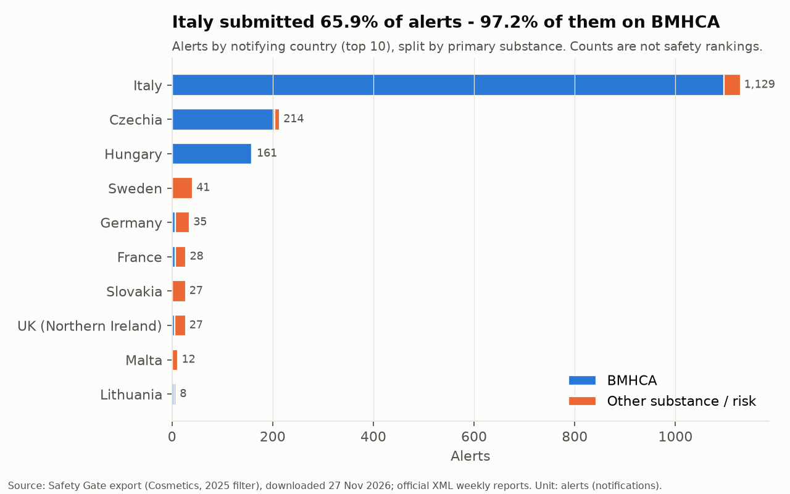
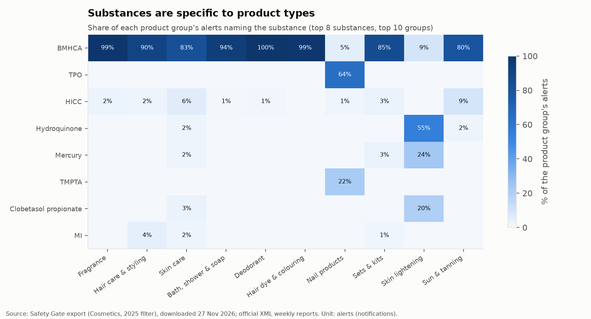
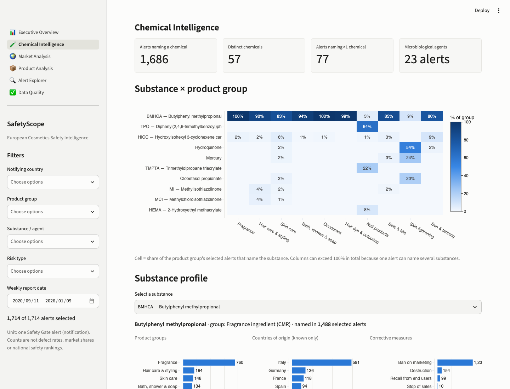
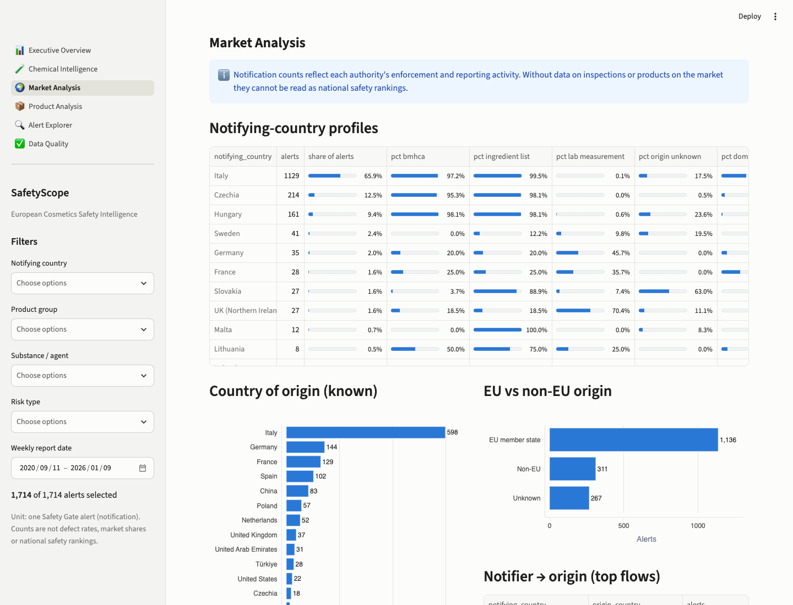
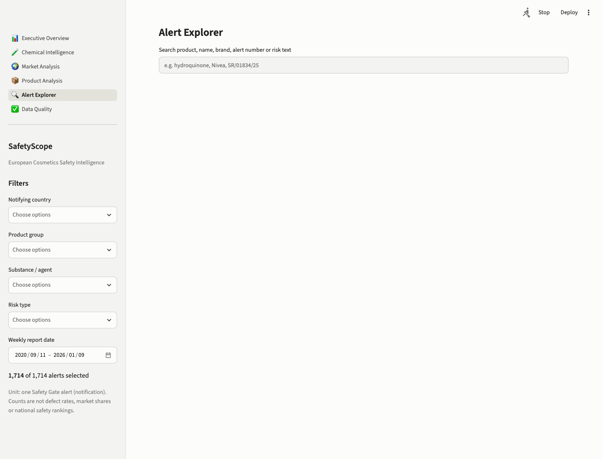
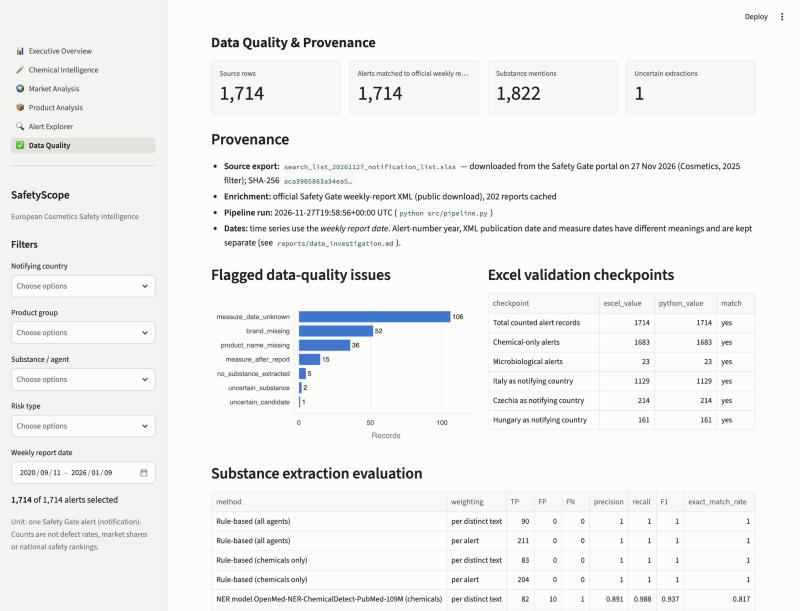

# SafetyScope — European Cosmetics Safety Intelligence

Turning the EU **Safety Gate** export of cosmetics alerts into a validated, queryable intelligence product:
a reproducible ETL pipeline, chemical-substance extraction from free text, a SQLite data model, a Streamlit
analytics app and Power BI assets.


## Business problem

Retailers, importers and regulatory-affairs teams need to know **which ingredients and products trigger EU safety
alerts, who notifies them and what corrective action follows**. Safety Gate publishes this information, but its
exports are semi-structured: substances are buried in sentences, several fields hold multiple values, spelling is
inconsistent and there is no date column.

## Data

- **Source:** Safety Gate portal export, category *Cosmetics*, 2025 filter, downloaded 27 Nov 2026 —
  1,714 alerts × 25 columns (`data/search_list_20261127_notification_list.xlsx`, unchanged).
- **Enrichment:** the Commission's public XML weekly reports (publication dates, report weeks).
- **Unit:** one alert = one notification by a national authority. Counts describe enforcement activity —
  **not** defect rates, market shares or national safety rankings.

## Main findings

| | Finding (verified from the data) |
|---|---|
| 1 | **BMHCA (Lilial)** is named in **86.8%** of alerts (1,488). It is on the EU list of prohibited cosmetic ingredients since 1 March 2022 (Regulation (EU) 2021/1902). |
| 2 | **Fragrances** account for **44.6%** of alerts; 99.5% of them concern BMHCA. |
| 3 | **Italy** submitted **65.9%** of alerts — 97.2% BMHCA, 99.5% identified from the ingredient list, median **359 days** from national measure to publication (other countries: 53). |
| 4 | Substances are product-specific: TPO/TMPTA in nail products; hydroquinone, mercury, clobetasol in skin-lightening products (mostly non-EU origin, mostly rejected at the border). |
| 5 | All **53 TPO** alerts appeared on or after **1 Sep 2025**, the date TPO's prohibition began to apply (Regulation (EU) 2025/877). |
| 6 | A **ban on marketing** follows in 75.4% of alerts; recalls from consumers in 8.2%. |

Interpretation, hypotheses and limits: [`reports/executive_summary.md`](reports/executive_summary.md).

<p>


</p>

## Methodology and architecture

```
Excel export ──► extract ──► transform ──────────────► load ──► CSV · SQLite · Power BI CSV/XLSX
(unchanged)      (header      (normalise, standardise,          │
                  row 2)       parse measures, regex NLP)       ├─► Streamlit app (app/)
Official XML ──► cached, rate-limited client ──► dates          ├─► SQL queries (sql/)
weekly reports                                                  └─► reports & figures (reports/)
```

| Stage | Output |
|---|---|
| Profiling & Excel reproduction | [`reports/data_profiling_report.md`](reports/data_profiling_report.md) — all 6 Excel checkpoints reproduced |
| ETL & cleaning | `src/pipeline.py`, [`reports/cleaning_report.md`](reports/cleaning_report.md), [`reports/date_investigation.md`](reports/date_investigation.md) |
| Substance extraction | 67-entry regex dictionary, PubChem-checked CAS numbers, [`reports/substance_extraction_evaluation.md`](reports/substance_extraction_evaluation.md) |
| Data model & SQL | [`docs/DATABASE.md`](docs/DATABASE.md), 20 queries in `sql/business_queries.sql` → [`reports/sql_results.md`](reports/sql_results.md) |
| Power BI | [`docs/POWER_BI_GUIDE.md`](docs/POWER_BI_GUIDE.md) |
| Automation | `src/update_from_api.py` (official XML) or drop Excel exports into `data/incoming/` |

## Application

Six pages: Executive Overview, Chemical Intelligence, Market Analysis, Product Analysis, Alert Explorer (search,
links to the original Safety Gate cases, CSV download) and Data Quality (provenance, checks, licence).

<p>




</p>

## Installation and usage

Requires Python 3.12 (3.10–3.12 should work).

```bash
python3.12 -m venv .venv
source .venv/bin/activate
pip install -r requirements.txt
```

Run the app (processed data is included, so this works immediately):

```bash
streamlit run app/streamlit_app.py
```

Then open <http://localhost:8501> in your browser. Stop it with `Ctrl+C` in the terminal.

Rebuild everything from the original export:

```bash
python src/pipeline.py            # ETL -> data/processed/ + SQLite
python src/profile_data.py        # profiling report
python src/investigate_dates.py   # date investigation (needs cached XML, see below)
python src/cleaning_report.py
python src/evaluate_extraction.py # reuses cached model predictions
python src/run_sql.py
python src/findings.py            # figures + executive summary
python src/build_powerbi.py
pytest
```

Optional:

```bash
python src/fetch_safety_gate.py --years 2025   # download official XML weekly reports (~2 min/year)
python src/update_from_api.py                  # add alerts published after the last update
pip install -r requirements-optional.txt && python src/evaluate_extraction.py --rerun-model   # re-run NER (~1 GB RAM)
```

## Evaluation and testing

- 46 automated tests (`pytest`): original file unchanged (SHA-256), Excel checkpoints, keys and referential
  integrity, measure parsing, extraction rules, every app page, Power BI schema validity, offline API ingestion.
- Substance extraction: agreement with **AI-produced** reference labels on 60 texts (rules 1.00; pretrained NER
  precision 0.89 / recall 0.99). Labels await human review in `data/review/substance_review_for_owner.xlsx`.

## Limitations

- One export; the portal's year filter is undocumented (best-fitting rule reproduces all rows, see date report).
- No denominators (inspections, products on the market) — no rates or rankings.
- Product groups are project-defined; the substance dictionary was built on the evaluated data.
- Power BI project files were not opened in Power BI Desktop (Windows-only).

## Licensing and attribution

Code: MIT ([`LICENSE`](LICENSE)). Data: European Commission terms — see [`DATA_LICENSE.md`](DATA_LICENSE.md).

> Alerts from the Rapid Alert System for dangerous non-food products, published free of charge on the Safety Gate
> website (https://ec.europa.eu/safety-gate-alerts) © European Union, 2005 – 2026

Developed with an AI coding assistant; see [`docs/PROJECT_JOURNAL.md`](docs/PROJECT_JOURNAL.md) for the division of work.
Further reading: [learning guide](docs/LEARNING_GUIDE.md) · [decision log](docs/DECISION_LOG.md) ·
[data dictionary](docs/DATA_DICTIONARY.md) · [project plan](docs/PROJECT_PLAN.md).
