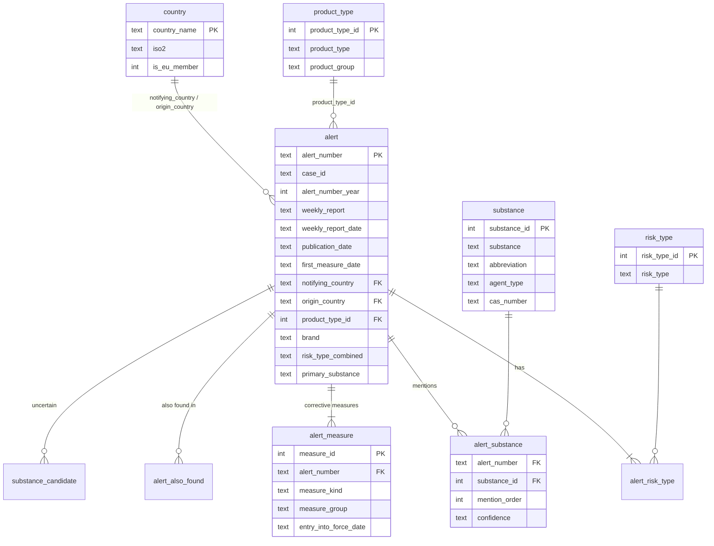

# SQLite Database

File: `data/processed/safetyscope.db` (rebuilt from scratch by `python src/pipeline.py`; schema in `sql/schema.sql`).

## Data model

One **fact table** (`alert`, one row per Safety Gate alert) surrounded by **dimension tables** (descriptive lookups)
and **bridge tables** for fields that can hold several values per alert.

| Table | Grain (one row per …) | Rows |
|---|---|---|
| `alert` | alert | 1,714 |
| `alert_risk_type` | alert × risk type | 1,718 |
| `alert_substance` | alert × substance/agent | 1,822 |
| `alert_measure` | corrective measure | 2,027 |
| `alert_also_found` | alert × additional country | 64 |
| `substance_candidate` | uncertain extraction | 1 |
| `product_type`, `substance`, `risk_type`, `country` | dimension value | 180 / 67 / 6 / 56 |
| `raw_export` | untouched export row | 1,714 |

## Why bridge tables?

An alert can name several substances (e.g. BMHCA **and** HICC) and have several measures (e.g. withdrawal **and**
destruction). Storing them in one text cell makes them impossible to count; storing them as extra columns
(`substance_1`, `substance_2`, …) breaks as soon as an alert has one more. A bridge table holds one row per pair.

## The double-counting rule

Joining a bridge table multiplies rows: 1,714 alerts become 2,027 rows after joining `alert_measure`
(query `q18_double_counting_demo`). Therefore **every query that joins a bridge table counts
`COUNT(DISTINCT alert_number)`**. Percentages of "alerts with substance X" can add up to more than 100 %
because one alert can contain several substances — this is stated wherever it applies.

## Queries

`sql/business_queries.sql` contains 20 commented queries answering business questions. `python src/run_sql.py`
executes all of them and writes the results to `reports/sql_results.md` — a query that fails stops the script.
